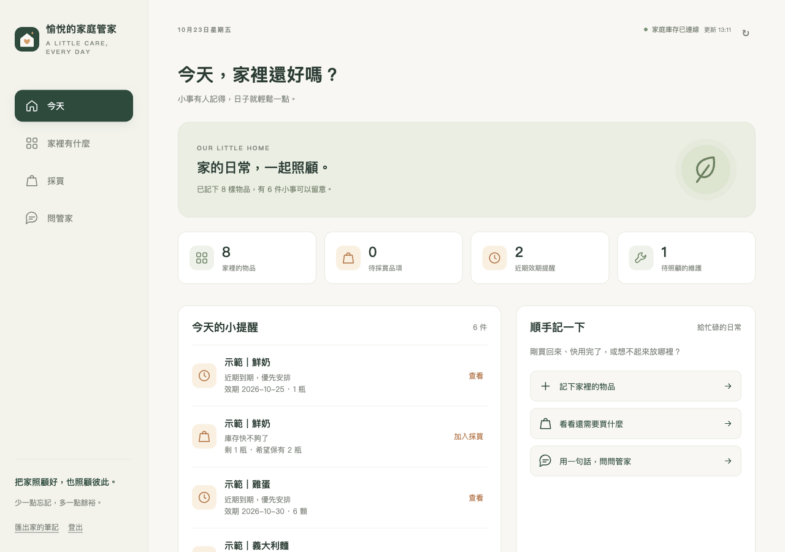

# 愉悅的家庭管家 · Joyful Home

給兩個人一起使用的家庭物品管理網頁。先照顧食材與家用品：知道家裡有什麼、放在哪裡、該買什麼，以及何時需要清潔或更換。

手機和電腦使用相同網址、同一份家庭資料。**阿魚是家人，AI 助理稱為「管家」。**

## 日常使用

- **今天**：查看快到期食材、低庫存用品與維護日期。
- **家裡有什麼**：搜尋、分類、新增及編輯物品，記錄購買、消耗、位置與規格。
- **採買**：共用食材與家用品清單，買完依實際數量入庫。
- **問管家**：用繁體中文查詢與整理家庭紀錄；寫入前顯示辨識結果，再一鍵套用。

自然語言範例：

> 家裡還有多少牛奶？
>
> 買了兩瓶洗衣精，放在陽台櫃子。
>
> 今天晚餐可以做什麼？優先用快到期的食材。
>
> 延長線放在哪裡？
>
> 今天換了廚下濾芯。

桌面畫面（僅使用明確標示的示範資料）：



[手機版畫面](docs/screenshots/mobile.png)

## 架構

```text
手機 / 電腦瀏覽器
       │
       ▼
愉悅的家庭管家（FastAPI + 原生 HTML / CSS / JavaScript）
       ├── Grocy API → 庫存、效期、地點、採買與物品附加資料
       └── Gemini API → 中文理解、資料查詢、操作提案
```

[Grocy](https://github.com/grocy/grocy) 是唯一的庫存資料來源。這個專案提供中文手機介面與對話整合，不另外複製一份庫存資料庫。它是獨立 companion app，並非 Grocy 官方版本。

AI 回答會取得當下庫存與日期；未知的數量、位置或效期應補問。推薦食譜不會自動扣庫存。前端不持有 Grocy 或 Gemini API 金鑰。

## 本機啟動

需要 Docker Compose 與 Python 3；應用程式本身在容器內使用 Python 3.12。

```bash
git clone https://github.com/Yueh-H/joyful-home.git
cd joyful-home
python3 scripts/setup_grocy.py
docker compose --profile app up -d --build
```

設定腳本初始化此專案專用的 Grocy 服務與本機設定。登入資訊保存在忽略版控的 `.local-access.txt`，請從該檔取得家庭密碼。請勿把這個檔案或 `.env` 上傳至 GitHub。

開發時也可使用主機上的 Python 3.12+ 與 [uv](https://docs.astral.sh/uv/)：先停止 `app` 容器以釋放連接埠，保留 Grocy，再執行：

```bash
docker compose stop app
uv sync --extra dev
uv run uvicorn server.app:app --host 0.0.0.0 --port 8765
```

在電腦開啟 `http://localhost:8765`。手機與電腦在同一個 Wi-Fi 時，使用電腦的區網 IP，例如 `http://192.168.1.100:8765`。伺服器和 Docker 必須保持執行；localhost 只代表開啟網頁的那部裝置。

### 啟用自然語言

後端環境需要 `GEMINI_API_KEY`，模型可用 `GEMINI_MODEL` 調整。可透過執行環境或本機 `.env` 設定；以 `.env.example` 為欄位參考。請使用自己有權使用的 API 金鑰。

沒有金鑰時，物品管理與採買仍可使用；聊天介面會顯示尚未啟用。使用 Gemini 時，當下家庭庫存、採買與近期操作紀錄會隨問題及對話脈絡傳至該服務，API 使用可能產生費用。

### 示範資料

正式使用從空資料開始。測試時可明確加入可辨識的示範物品：

```bash
uv sync --extra dev
uv run python scripts/seed_demo.py --confirm-demo
```

示範資料不是家中真實庫存。匯入前請閱讀腳本的執行提示，不要把測試盤點當成實際採買紀錄。

僅在資料仍全部為這個腳本的示範品項時，可以明確清除它們，保留服務設定：

```bash
uv run python scripts/seed_demo.py --clear-demo --confirm-demo
```

若已有任何真實品項，腳本會拒絕清除。請先在另一個測試環境試用，或在開始登錄真實庫存前完成示範。

## 手機與家庭共用

- 兩部手機登入同一個家庭服務，即讀取同一份 Grocy 資料。
- 網頁會重新載入最新資料；需要網路連線，不能離線修改庫存。
- 安裝到主畫面與 service worker 需要 HTTPS（或本機 localhost）；一般區網 HTTP 仍能瀏覽使用。
- 要在外面或全天使用，請將服務放在常開主機 / NAS，設定 HTTPS 與家庭登入；也可以經由自己的私人網路連回家。
- 本專案初版供單一家庭使用，並未提供多租戶帳號系統。
- 初版提醒顯示在網頁內；關閉網頁後的手機推播尚未提供。
- 同一物品可有不同批次效期；總覽顯示最早效期，編輯效期／開封狀態作用於最近效期批次。補貨時可填新批次效期。

## 開源與私人資料

本專案以 MIT 授權公開程式碼。家庭資料、API 金鑰、登入密碼、Docker volumes 和執行紀錄不屬於公開 repo。

GitHub 用於原始碼和版本管理；GitHub Pages 的靜態服務不能單獨執行 Grocy 與這個後端。

停止容器時不要移除資料 volume。資料備份需要包含 `data/grocy/`（完整庫存）、`app-data` volume（登入、提案與操作紀錄）與本機設定（分開安全保存）；網頁 JSON 匯出提供可讀資料副本，不等同完整服務還原。

## 驗證

```bash
uv run pytest -q
node --check web/app.js
node --check web/contracts.js
node --check web/sw.js
docker compose config --quiet
```

實際執行結果、瀏覽器檢查與尚未完成項目見 [驗證紀錄](docs/verification.md)。API 及資料欄位見 [開發契約](docs/contract.md)。

## 上游與授權

- [Grocy 原始碼](https://github.com/grocy/grocy) / [官方功能](https://grocy.info/)
- [Gemini structured outputs](https://ai.google.dev/gemini-api/docs/structured-output)
- [MIT License](LICENSE) / [第三方說明](THIRD_PARTY.md)
